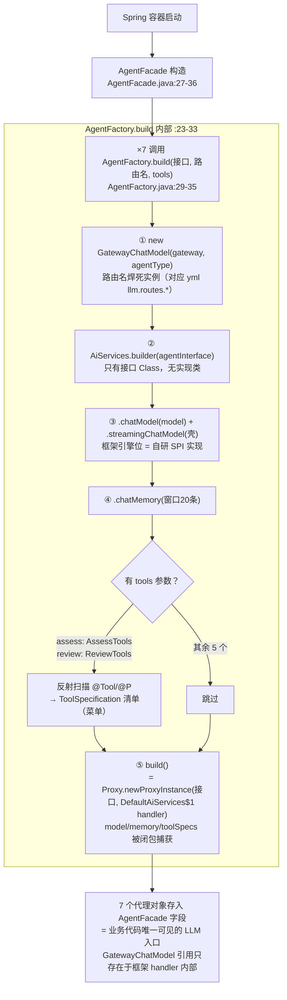
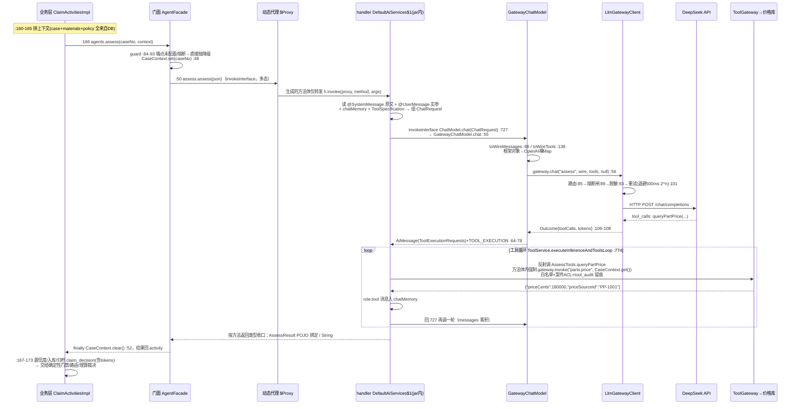

# claim-pro 设计文档（DESIGN）

版本：v1.2.1 ｜ 日期：2026-11-25 ｜ 状态：定稿（与 REQUIREMENTS.md v1.2.0 配套）
口径：**商用生产架构**（非本地内置版）；消息层 **RocketMQ**（替代 Kafka）；编排 Temporal；agent 框架 LangChain4j；主力模型 DeepSeek。
v1.2.1 变更：§17 增补 17.6-17.8——LangChain4j 装配过程与运行全流程（装配流程图/运行时序图/动态代理分派机制），含 jar 字节码取证与最小可运行复现实测（2026-11-25），并如实记录 ChatMemory 共享窗口边界。
v1.2.0 变更：第二轮增强（§11.20）；§8 数据字典补全至 23 表；新增 §13 架构视图（组件/部署/安全）、§14 关键时序图、§15 API 契约、§16 错误处理与降级矩阵、§17 LLM 应用机制详解（逐场景：通用调用链路/机制矩阵/定损工具循环/真实输出样例）。
v1.1.0 变更：新增 §11 业务流程设计详解（P0 实现如实描述，含每条流程的设计方案/步骤/实现位置/与生产差异）、§12 验证结果；§10.4/10.5 对齐当前交付现状。

**文档地图**：[REQUIREMENTS](REQUIREMENTS.md)（需求与验收映射）· **DESIGN**（本文：目标架构 + 实现详解）· [OPERATIONS](OPERATIONS.md)（操作手册）· [COLLABORATION](COLLABORATION.md)（协作决策复盘）· [README](README.md)（入口与快速开始）

---

## 1. 设计原则

1. **权力分层**：agent 产出事实/建议/解释/质疑；资格判定、金额、审批生效、资金划转归确定性核心；流程走向归 Temporal。LLM 的不确定性只存在于节点内部，不存在于流程与资金上。
2. **双网关收口**：工具调用一律经工具网关，模型调用一律经模型网关。审计、脱敏、限流、计量在网关层强制，不依赖业务自觉。
3. **记录系统边界**：保险核心系统是 System of Record；本系统只产出建议书，经审批后由核心既有接口执行登记。
4. **框架效率 + 自研控制**：LangChain4j 做 agent 编程模型（AiServices/@Tool/Guardrails/RAG），控制点（路由/脱敏/熔断/计量/审计）全部落在自定义 ChatModel 适配器与网关内。禁止 `OpenAiChatModel` 直配 apiKey 的 demo 用法。
5. **可回放**：每步决策带 trace_id、证据哈希、模型/prompt 版本，WORM 存档≥10 年。

## 2. 总体架构

```
渠道(App/话务/修理厂/开放API)
   │ API网关(OAuth2+mTLS)
   ▼
理赔编排域  Temporal 集群
   │  案件=workflow实例；activity=agent调用/规则/人工任务
   │  Task Queue 按 agent 类型分队列（持久化派发/重试/背压/隔离）
   ▼
Agent执行域  无状态 worker 池(K8s HPA 按队列深度)
   │  LangChain4j AiServices ×8（独立部署组/资源配额/发布节奏）
   ├──────────────┬───────────────────────┐
   ▼              ▼                       │
工具网关        模型网关                    │
(鉴权/限流/     (多端点路由/脱敏前置/        │
 审计/幂等/      熔断/语义缓存/计量/         │
 核心系统适配)   prompt版本/内容安全)        │
   │              │                       │
   ▼              ▼                       ▼
确定性核心域     模型层                  数据/事件层
规则引擎(Drools) DeepSeek flash(对话/抽取) MySQL集群(案件)
理算计算器(纯代码) DeepSeek chat(推理/复核)  RocketMQ(事件+事务消息)
审批流(分级授权)  私有VL(vLLM,影像不出域)    Redis(会话/缓存/锁)
支付服务(双账本)  OCR专用模型前置           ES+Milvus(条款/相似案件)
                XGBoost+图谱(欺诈,非LLM)   NebulaGraph(团伙关系)
                                         MinIO WORM(证据≥10年)
横切：OTel+SkyWalking · Prometheus/Grafana · 审计事件 · 金标集回归 · KMS
```

## 3. 技术选型（定稿）

| 层 | 选型 | 备注 |
|----|------|------|
| 语言/框架 | Java 21 + Spring Boot 3.2.x + Maven 多模块 | 与 cs-pro 基线一致；虚拟线程适配 IO 密集 |
| Agent 框架 | **LangChain4j 1.x**（core/open-ai/所需 store 模块，不引全家桶） | BOM 锁版本；升级走金标集回归；CVE 扫描进 CI |
| 主力模型 | DeepSeek 官方 API（OpenAI 兼容 `https://api.deepseek.com/v1`） | flash=对话/抽取；chat=推理/复核；**官方模型 ID ≠ 第三方平台 ID** |
| 影像/敏感 | DeepSeek-VL2 私有化（vLLM）；OCR 专用模型前置 | 影像/病历不出域；协议统一，迁移只改路由表 |
| 欺诈评分 | XGBoost/LightGBM（JPMML）+ NebulaGraph 图特征 | 非 LLM，可解释可年度验证 |
| 编排 | **Temporal**（Java SDK） | 长周期案件、人工 signal、流程版本灰度 |
| 消息 | **RocketMQ 5.x**（替代 Kafka） | 事件流 + 支付事务消息（半消息），见 §5 |
| 案件库 | MySQL 8 + ShardingSphere（机构+年份分片） | 与核心系统单向同步 |
| 缓存/锁 | Redis 7 集群（Redisson） | 敏感字段不落缓存 |
| 检索 | ES 8 + Milvus | 条款按出险日取版本 |
| 图谱 | NebulaGraph | T+1 批量+实时增量；P0 关系库存储全量重建（§11.18） |
| 证据 | MinIO/云 OSS + WORM 合规保留 | 哈希链防篡改 |
| 规则 | Drools（条款规则包，带生效日期） | 核赔师可参与维护 |
| 可观测 | OTel + SkyWalking + Prometheus/Grafana + Loki | trace_id 贯通 workflow→agent→工具→模型 |
| 批处理 | XXL-Job | 日终对账/图谱构建/金标回归；已落地 XXL-Job 2.4.1 调度中心（Docker :8094，ops-pro 纳管）+ 内嵌执行器 :9999 + 启动跑 + 手动 API；local 档位 Spring cron 兜底（§11.18/§11.19） |
| 部署 | K8s + Helm；开发/预发 docker-compose | 同城双活，异地质检 |
| 密钥 | 生产 KMS；开发 `~/.config/claim-pro/`（700/600） | 仓库只留 *.example |

## 4. 编排设计（Temporal）

### 4.1 工作流与队列

```java
@WorkflowInterface
public interface ClaimWorkflow {
    @WorkflowMethod void run(ClaimInput input);          // 案件主流程，workflowId=案件号
    @SignalMethod void onMaterialsSubmitted(MaterialBatch b);  // 补件
    @SignalMethod void onHumanDecision(HumanDecision d);       // 审批/拒赔确认/抽检改判
    @SignalMethod void onCustomerDispute(Dispute d);           // 异议升级
    @QueryMethod ClaimState state();
}
```

| Task Queue | Worker 组 | 说明 |
|-----------|----------|------|
| claim-intake | 受理/沟通 | 对话类，flash |
| claim-doc | 识别 | 大流量，独立限流 |
| claim-assess | 定损/理算建议 | |
| claim-review | 独立复核 | 物理隔离部署，只读工具 |
| claim-fraud | 欺诈汇总 | |
| claim-core | 规则/计算器/审批/支付 activity | 确定性核心，LLM 禁入 |

### 4.2 关键机制
- **人工节点**：activity 发起审批任务后 workflow `await(signal)`，durable timer 超时自动升级；
- **并行**：反欺诈 ∥ 定损，聚合门禁后分级路由；
- **版本灰度**：`Workflow.getVersion` 分支，新流程只接新案件，在途案件按旧版本跑完；
- **降级**：模型网关熔断全开 → activity 返回 DEGRADED → workflow 转纯人工通道，不停摆；
- **幂等**：activity 幂等键=案件号+步骤号+批次号；支付重复请求返回原结果。

## 5. 消息层设计（RocketMQ，替代 Kafka）

### 5.1 职责划分

| 职责 | 承载 | 说明 |
|------|------|------|
| 编排→agent 任务分发 | **Temporal Task Queue** | 不用 MQ 重复建设 |
| 决策/审计事件流 | RocketMQ 普通消息（顺序，按案件号分区） | 消费方：审计归档、数仓、指标 |
| 支付一致性 | **RocketMQ 事务消息（半消息）** | 本地事务=账本落库；回查=查账本状态 |
| 通知/异步任务 | RocketMQ 普通消息 | 客户通知、标注回流 |

### 5.2 Topic 规划

| Topic | 类型 | 消息键 | 消费方 |
|-------|------|--------|--------|
| claim-decision-events | 顺序消息 | 案件号（MessageQueueSelector） | 审计归档(WORM)、数仓、指标 |
| claim-pay-tx | 事务消息 | 案件号+赔付批次 | 支付执行、核心系统登记 |
| claim-notify | 普通 | 案件号 | F8 沟通、短信/推送网关 |
| claim-feedback | 普通 | 案件号 | 人工改判回流→标注平台 |

### 5.3 支付事务消息流程

```
1. 发送半消息(claim-pay-tx) ── broker 暂存不可见
2. 执行本地事务：双账本记账 + outbox 落库（同库同事务）
3. COMMIT → 消息可见 → 支付执行器划款 → 核心登记
   ROLLBACK → 消息丢弃
4. broker 回查（网络断/进程崩）：查 outbox/账本状态 → 补 COMMIT/ROLLBACK
5. 日终三层对账兜底：账本 vs 银行回执、本系统 vs 核心、建议 vs 计算器
```

### 5.4 审计事件 schema（claim-decision-events）

```json
{ "traceId": "...", "caseNo": "...", "step": "ASSESS", "actor": "agent-assess",
  "modelVersion": "deepseek-chat@2026-11", "promptVersion": "assess-v3",
  "inputHash": "sha256:...", "evidenceRefs": ["ev-001"],
  "output": {...}, "confidence": 0.92, "tokens": {"prompt": 1800, "completion": 400},
  "ts": "2026-11-18T10:00:00Z" }
```

## 6. Agent 层设计（LangChain4j）

### 6.1 集成点（全部走框架正式扩展位）

```java
// 控制点收口：自定义 ChatModel，内部委托模型网关客户端
public class GatewayChatModel implements ChatLanguageModel, StreamingChatLanguageModel {
    private final LlmGatewayClient gateway;   // 路由/脱敏/熔断/重试/缓存/计量
    private final String agentType;           // → 路由表选端点
}

// agent 声明式定义（⑦复核示例）
ReviewAgent agent = AiServices.builder(ReviewAgent.class)
    .chatModel(new GatewayChatModel(gateway, "review"))
    .tools(reviewTools)                        // @Tool 方法体内强制走工具网关
    .chatMemoryProvider(id -> redisChatMemory(id))
    .contentRetriever(clauseRetriever)         // 条款 RAG，按出险日取版本
    .guardrails(complianceGuardrails)          // 输出不得含赔付承诺
    .build();
```

- `ChatModelListener`：onResponse → 证据快照(WORM) + token 计量 + OTel span；
- `ToolProvider` SPI：案件级动态授权（复核只读；定损不可碰支付类工具）；
- 结构化输出：JSON Output 模式 + POJO 映射 + Jackson 校验，低置信度转人工。

### 6.2 DeepSeek 路由表（模型网关配置）

| agentType | 端点 | 模型 | 说明 |
|-----------|------|------|------|
| intake / notify | 官方 API | deepseek-flash | 高频对话 |
| doc-extract | 官方 API | deepseek-flash + JSON mode | OCR 文本后结构化 |
| doc-vision | 私有 vLLM | deepseek-vl2 | 影像不出域 |
| assess / coverage-explain | 官方 API | deepseek-flash | 估价依据/条款解释 |
| review / calculation-draft | 官方 API | deepseek-chat | 强推理，量小 |
| fraud-report | 官方 API | deepseek-chat | 线索汇总成报告 |

端点按 baseUrl+model 显式配置，不做跨平台名称翻译。长 system prompt（条款库）固定前缀，利用 DeepSeek 上下文缓存计费优惠。

### 6.3 模型网关客户端（移植 cs-llm 已验证模式）

保留：JDK HttpClient 零 SDK、按端点熔断（连续 5 败熔 60s，half-open 探测）、分类退避重试（429/5xx/网络≤2 次；4xx 与已出流不重试）、流式/工具调用双模式、usage 计量。
新增：多端点路由、故障切换备用端点、脱敏前置（身份证/银行卡/手机号）、语义缓存（Redis）、prompt 版本注入、内容安全过滤、成本落账到案件。

## 7. 确定性核心域（LLM 禁入）

| 组件 | 设计 |
|------|------|
| 条款规则引擎 | Drools 规则包，按出险日取条款版本；输出命中条款/免责项，供 F3 解释 |
| 理算计算器 | 纯 Java：免赔/折旧/限额/比例；与 F6 草案双跑比对，差异落监控 |
| 审批流 | 额度分级授权；>10 万双人；拒赔必须人工确认 |
| 支付服务 | 持牌通道/银企直连；双账本（业务账+资金账）；幂等键=案件号+批次；日终对账+银行回执核对+长短款挂账+差错处理台 |

## 8. 数据模型（完整数据字典，23 表）

> 与 `claim-gateway/src/main/resources/schema.sql`（H2）及 `deploy/mysql/001_schema.sql`（MySQL）逐表对齐。金额一律 **BIGINT 分**；时间戳一律 **BIGINT 毫秒**（审计可读时间另由 FROM_UNIXTIME 转换）。按业务域分组。

**① 案件域**

| 表 | 主键 | 关键列 | 说明 |
|----|------|--------|------|
| claim_case | case_no | policy_no, org, insurance_type, accident_date, accident_type, status(12态), channel(4通道), estimate_cents, payable_cents, risk_score, recognition_confidence, reject_reason, description, created_at, updated_at | 案件主数据；status/channel 字典见 §11.0 |
| claim_material | id（material_id UNIQUE） | case_no, type(ACCIDENT_REPORT/DAMAGE_PHOTO…), storage_key, sha256(内容哈希), confidence, file_name, content_type, size_bytes | 材料；size_bytes=NULL 表示仅元数据登记无文件本体 |
| claim_approval | id | case_no, step(APPROVE/REJECT_CONFIRM/MANUAL_HANDLE), operator, approved(0/1), comment, amount_cents, ts | 人工决策留痕；管道轮询/signal 消费 |

**② 保单与价格（确定性输入）**

| 表 | 主键 | 关键列 | 说明 |
|----|------|--------|------|
| policy_snapshot | policy_no | effective_date, expiry_date, coverage_types(逗号串), limit_cents, deductible_cents, depreciation_percent, clause_version | 保单快照，核心系统适配加载，规则引擎只读 |
| part_price | id | model_code, part_name, price_cents, source_id | 配件价格库；定损价格唯一来源（带 source_id 溯源） |

**③ 资金域（双账本 + 一致性）**

| 表 | 主键 | 关键列 | 说明 |
|----|------|--------|------|
| ledger_business | id | case_no, batch, direction(PAYABLE), amount_cents, ts | 业务账（案件维度应收应付） |
| ledger_fund | id | case_no, batch, fund_channel, direction(OUT), amount_cents, ts | 资金账（渠道维度实收实付） |
| pay_outbox | idem_key | case_no, batch, amount_cents, fund_channel, status(COMMITTED/ROLLED_BACK), ts | 支付本地事务表；幂等键=案件号:PAY:批次；事务消息回查依据 |
| recon_diff | id | case_no, batch, biz_amount, fund_amount, status(OPEN/RESOLVED), ts | 对账差异（业务账 vs 资金账） |
| core_register | case_no | result, ts | 核心系统登记幂等表（重复登记返回原结果） |

**④ 证据与审计（可回放）**

| 表 | 主键 | 关键列 | 说明 |
|----|------|--------|------|
| evidence_index | id | case_no, seq, evidence_id, object_key, sha256, prev_hash, step, ts | 证据哈希链索引；digest=SHA256(prev_hash\|output)，对象字节存 MinIO/本地（§11.13） |
| claim_decision | id | trace_id, case_no, step, actor, model_version, prompt_version, input_hash, output_json, confidence, prompt_tokens, completion_tokens, ts | 决策事件（与 RocketMQ 事件同构，本地归档副本） |
| tool_audit | id | tool_name, case_no, args_json, result_json(截2000), ts | 工具网关全量调用留痕 |

**⑤ 欺诈图谱域**

| 表 | 主键 | 关键列 | 说明 |
|----|------|--------|------|
| graph_case_shop | id（case_no+shop_name UNIQUE） | case_no, shop_name, source(INTAKE…), ts | 案件↔修理厂关联登记 |
| repair_shop_flag | id | case_no, shop_name, reason, source(MANUAL/GRAPH_BATCH) | 修理厂风险标记；重建只清 GRAPH_BATCH，MANUAL 永久保留 |
| graph_node | (node_type, node_key) | label, props_json, ts | 图谱节点 CASE/POLICY/SHOP（T+1 重建） |
| graph_edge | id | src_type, src_key, dst_type, dst_key, edge_type(INSURED_BY/REPAIRED_AT), ts | 图谱边 |
| graph_build_run | id | ts, trigger_by, node_count, edge_count, shop_count, new_flag_count, duration_ms | 图谱构建运行记录 |

**⑥ 模型治理域（金标/双跑/影子）**

| 表 | 主键 | 关键列 | 说明 |
|----|------|--------|------|
| gold_run | id | ts, trigger_by, total, passed, failed, duration_ms | 金标回归运行（2018 案） |
| gold_case_result | id | run_id, gold_id, name, passed, mismatches_json, ts | 金标逐案结果 |
| calc_dual_run | id | case_no, calc_payable_cents, draft_payable_cents, diff_cents, is_match, draft_json, ts | F6 理算双跑（计算器 vs LLM 草案） |
| shadow_run | id | ts, config_json, total, drift_count, samples_json, duration_ms | 影子双跑（候选阈值重放历史案） |

**⑦ 条款域**

| 表 | 主键 | 关键列 | 说明 |
|----|------|--------|------|
| clause_text | clause_id | version, code(CLAUSE-*/EXCL-*), title, body, effective_from, effective_to | 条款原文库；核保解释 RAG 引用 + 向量化入 Qdrant（§11.20） |

**分片与保留**：claim_* 按机构+年份分片（ShardingSphere，生产）；账本按机构。审计事件 RocketMQ→数仓保留≥10 年，本地 claim_decision 副本滚动 90 天；证据对象 MinIO WORM≥10 年。
**增量 DDL**：存量库按序执行 deploy/mysql/003_material_files.sql（材料三列）→ 004_calc_dual_run.sql → 005_clause_text.sql → 006_shadow_run.sql（均幂等）；新环境 001 已含全部 23 表。

## 9. 可观测与 LLMOps

- trace_id 贯通：API→Temporal workflow→activity→agent→工具网关→模型网关；
- 核心指标：人工推翻率（>5% 告警并降级该通道）、置信度分布、熔断状态、单案件 token 成本、通道时效；
- 发布流水线：prompt/模型/框架版本变更 → 金标集回归（≥2000 案件）→ 影子 2–4 周 → 灰度 5%→25%→100%；
- 人工改判经 claim-feedback 回流标注平台，驱动微调/规则修订。

## 10. 工程结构与部署

### 10.1 Maven 多模块

```
claim-pro/
├── REQUIREMENTS.md / DESIGN.md / OPERATIONS.md / COLLABORATION.md / README.md
├── claim-common          # 案件模型/幂等键/审计事件/端口接口
├── claim-llm             # 模型网关客户端 + GatewayChatModel + 路由/脱敏/计量
├── claim-agent-runtime   # AiServices 装配/工具注册/Guardrails/记忆
├── claim-agents          # agent 接口与 @Tool 工具集（P0 六门面，见 §11.15）
├── claim-core            # 规则引擎/理算计算器/审批/双账本（LLM 禁入）
├── claim-workflow        # Temporal workflow/activity 定义与 worker + 本地开发管道
├── claim-mq              # RocketMQ 事件发布/事务消息/消费者
├── claim-infra           # MySQL/Redis/ES/Milvus/MinIO/图谱 适配器
├── claim-gateway         # 工具网关 + 开放 API（Spring Boot 主应用, 端口 8097）
├── deploy/               # docker-compose(开发/预发) + helm(生产)
├── config/*.example      # 真实密钥 ~/.config/claim-pro/（700/600）
└── run.sh / stop.sh / smoke-test.py
```

### 10.2 基础设施编排（deploy/docker-compose.yml，开发/预发）

| 服务 | 镜像 | 端口 |
|------|------|------|
| temporal | temporalio/auto-setup | 7233（UI 8088） |
| rocketmq-namesrv | apache/rocketmq | 9876 |
| rocketmq-broker | apache/rocketmq | 10911 |
| rocketmq-dashboard | apacherocketmq/rocketmq-dashboard | 19876 |
| mysql | mysql:8 | 3306 |
| redis | redis:7 | 6379 |
| minio | minio/minio | 9000（console 9001） |

ES/Milvus/NebulaGraph 属 P1+ 阶段，届时追加；P0 条款检索可先 MySQL 全文索引过渡。

### 10.3 生产部署

K8s + Helm：每类 agent 独立 Deployment（HPA 按 Task Queue 深度）；Temporal/RocketMQ/MySQL 同城双活；模型网关多副本；私有 vLLM GPU 池独立命名空间。RPO≈0（半同步复制）、RTO<30min。

### 10.4 本机开发约束（如实标注，2026-11-18 现状）

本机已装 Docker Desktop（引擎 29.9.3/Compose 5.7.0）：中间件统一由 **ops-pro（8098）** 的 claim-shared compose 栈管理（Temporal/RocketMQ×3/MySQL/Redis/MinIO/ZooKeeper×2/**XXL-Job 调度中心 :8094**），claim-pro 与 cs-pro 共用 MySQL/RocketMQ/Redis。MinIO 社区版上游已停止预编译分发，镜像由 **GitHub 源码多阶段构建**（配方 ops-pro/deploy/minio-from-source.Dockerfile，S3 往返实测通过）。应用编译用 mvnw。

**三档 profile（2026-11-18 起默认 mysql）**：
- `local`：零依赖开发，H2 文件库 + 本地文件系统证据库 + LocalLogEventPublisher + LocalPipelineRunner；
- `mysql`（默认）：**MySQL claim 库**（claim-shared-mysql，专用账号 claim，口令 `~/.config/claim-pro/claim.properties`）+ 本地编排/事件/证据件 + **XXL-Job 执行器**（调度中心 claim-shared-xxl-job-admin :8094，accessToken 同文件）；库表由 `deploy/mysql/001_schema.sql` 初始化（20 表，`sql.init.mode=never`），种子 `002_seed.sql`；H2→MySQL 一次性迁移工具 `deploy/mysql/MigrateH2ToMysql.java`（H2 只读、逐表行数校验、失败回滚，原 H2 文件保留作备份）；
- `default`：全栈生产档位，Temporal/RocketMQ/MinIO 全启用，须由 ops-pro 先起中间件。

无中间件时以 `CLAIM_PROFILE=local` 启动，启动即告警非生产编排。DeepSeek 联调需 `~/.config/claim-pro/` 配置 Key，未配置时 AI 端点 503、流程走人工降级通道。local/mysql 档位静态资源从源码目录热加载且强制 `Cache-Control: no-cache, must-revalidate`（防浏览器缓存旧样式）。

### 10.5 P0 实现简化清单（与目标架构的差异，如实标注）

- **Task Queue**：✅ 已拆六队列物理隔离（claim-core/intake/doc/assess/review/fraud，独立 worker 限流，§11.20）；生产 K8s 按队列独立 Deployment+HPA 属部署项；
- **本地开发管道**：`claim.temporal.enabled=false` 时由 LocalPipelineRunner 以同构状态机跑流程，人工节点轮询 claim_approval 表（2s）代替 signal，等待窗口 30 分钟；重启后经 ApplicationReadyEvent 按案件状态续接等待节点（REPORTED/MATERIALS_PENDING/APPROVING/MANUAL），其余中间态告警不自动续接——生产一律 Temporal durable 恢复，无此限制（详见 §11.16）；
- **欺诈评分**：✅ 规则评分器 + XGBoost(JPMML) 模型适配器双策略（`claim.fraud.strategy`，默认 rules，§11.20）；模型为合成样本演示版，生产换真实标注案重训；反欺诈 agent 仅做报告汇总；
- **报案结构化**：P0 为表单直填 + 可选 LLM 结构化增强（`/api/agent/intake`，503 降级不影响建案）；关键词提取用于确定性核心的免责事由与责任比例判定（§11.3/§11.6），非 LLM 职责；
- **识别置信度**：✅ 视觉定损（doc-vision 多模态端点）输出真实置信度 + <0.85 转人工门禁（§11.20）；未配视觉 Key 降级文本定损固定 0.9；真实影像调用待配 Key 验证；
- **理算草案双跑**：✅ F6 LLM 草案 vs 计算器双跑，差异落 calc_dual_run + 监控 API（§11.20），降级单跑；
- **支付**：P0 为模拟支付 activity + 双账本落库（事务消息链路代码完整，local 无 MQ 时直连账本），真实渠道对接属 P1；
- **条款检索**：✅ Drools 10.2.0 规则包 + 条款原文向量 RAG（共享栈 Qdrant+本地 ONNX，§11.20）；多版本规则包按出险日加载属生产扩展；
- **复核**：✅ F7 嵌入主流程强制门禁（claim-review 队列，质疑→MANUAL 深查，独立卷宗 R2，§11.20）+ 按需 API 保留；独立部署组属生产部署项；
- **批处理调度**：mysql/default 档位已接 **XXL-Job 2.4.1**（调度中心 Docker :8094，执行器 claim-pro-executor :9999，图谱 02:30 / 金标 03:00，trigger_by=XXL_JOB）；local 零依赖档位由 Spring `@Scheduled` 兜底（`claim.batch.*-cron` 可配，条件装配防双调度）；启动各跑一次 + 手动 API 保留，失败不阻断主链路；XXL-Job 分片广播属 P1（§11.18/§11.19）；
- **图谱存储**：✅ 关系库 T+1 重建（对账基线）+ NebulaGraph 实时增量适配器（`claim.graph.nebula.enabled`，可选，§11.20）；单节点开发拓扑，生产集群化属部署项；标记规则与回写语义不变；
- **金标集规模**：✅ 2018 案（18 手工 + 2000 合成，独立 Python oracle 推导期望值）+ 影子双跑 + 灰度发布（§11.20）；真实标注案替换合成集 + 2–4 周影子观察属上线运营项。

## 11. 业务流程设计详解（P0 实现，as-built）

> 本节按代码如实描述每条业务流程的**设计方案、执行步骤、实现位置与生产差异**。
> 总原则贯穿所有流程：**状态迁移只由编排代码决定；金额只由计算器/人工决策决定；agent 输出只作建议与解释；每一步都落决策事件 + 证据哈希链。**

### 11.0 主流程总览与状态机

```
报案 POST /api/claims（同步建案，API 返回前案件行必存在）
  │
  ▼
材料齐套门禁 ─不齐→ MATERIALS_PENDING（等补件 signal / 本地 2s 轮询）
  │齐（认定书+照片）        └─ 期间客户异议 → MANUAL
  ▼
COVERAGE_CHECK  规则引擎核保
  ├─免责→ APPROVING（拒赔确认节点）─人工确认→ REJECTED + 通知
  │                              └─未确认/异议→ MANUAL
  ▼属保险责任
ASSESSING  反欺诈评分 ∥ 定损（并行）
  │任一失败（模型/识别不可用）→ MANUAL（显式降级，归档原因）
  ▼
ROUTE  分级路由（risk × 金额 × 置信度）
  ├─ INVESTIGATE / MANUAL → MANUAL（SIU 调查 / 人工处理）
  ▼ FAST / STANDARD
CALCULATE  理算计算器（纯代码）
  ▼
APPROVING  分级审批（FAST 免人工；任一驳回 → REJECTED + 通知）
  ▼ 批准数达标
PAYING  双账本 + 事务消息 → CORE_REGISTER 核心登记 → SETTLED + 通知 → CLOSED
```

**状态字典（12 态）**：REPORTED 已报案 / MATERIALS_PENDING 待补件 / COVERAGE_CHECK 核保中 / ASSESSING 定损中 / ROUTED 已分级 / CALCULATED 已理算 / APPROVING 审批中 / PAYING 支付中 / SETTLED 已赔付 / REJECTED 已拒赔 / MANUAL 人工处理 / CLOSED 已结案。
**通道字典（4 色）**：FAST 快赔 / STANDARD 标准 / INVESTIGATE 调查 / MANUAL 人工。

**双编排同构**：同一套 activity（ClaimActivitiesImpl）被两种编排驱动——生产 `ClaimWorkflowImpl`（Temporal，signal+durable await）与本地 `LocalPipelineRunner`（线程池状态机，轮询 claim_approval 表）。业务规则只写一份在 activity/核心域，编排层只做「等待与迁移」，保证两档位行为一致。

实现：claim-workflow/ClaimWorkflowImpl.java、LocalPipelineRunner.java、ClaimActivitiesImpl.java。

### 11.1 报案受理（FNOL）

**设计方案**：报案是资金链路的起点，必须「API 返回即有案」——同步建案消除竞态（避免返回案件号后查不到行），编排启动异步化。案件号全局唯一可追溯；LLM 结构化是**可选增强**而非前置依赖，未配 Key 不阻塞立案。

**流程**：
1. 前端表单提交：保单号/险种（默认 AUTO）/出险日（默认今天）/事故类型/描述；机构默认 HEAD；
2. `CaseService.report()` 生成案件号 `CLM-YYYYMMDD-XXXXXX`（UUID 前 6 位大写）；
3. 编排启动：Temporal `WorkflowStarter.start()`（workflowId=案件号）或本地 `LocalPipelineRunner.start()`；两者都**先同步 createCase**；
4. `createCase` activity 幂等：案件已存在直接返回（Temporal activity 重试安全）；落 claim_case（REPORTED）+ 归档 REPORT 证据；
5. API 返回案件行；管道异步进入材料门禁。
6. 可选：`POST /api/agent/intake` 调受理 agent 把口语描述转结构化 JSON（accidentType/location/requiredMaterials，不确定填 null 不得编造）；端点不可用返回 503，前端提示降级，不影响报案。

**实现**：claim-gateway/api/CaseService.java:48、ClaimActivitiesImpl.createCase、claim-agents/IntakeAgent.java。
**生产差异**：渠道侧加 API 网关 OAuth2+mTLS；受理 agent 支持对话式多轮 FNOL（P0 为单轮表单+可选结构化）。

### 11.2 材料补件与齐套门禁

**设计方案**：材料是核保/定损的证据基础，齐套判定是**确定性规则**（两类单证齐全），不由模型判断。补件是人工节点：生产用 signal 唤醒，本地用轮询发现，门禁循环可多次往返。

**流程**：
1. 管道检查 `materialsComplete`：存在 ACCIDENT_REPORT（事故认定书）**且** DAMAGE_PHOTO（损伤照片）两类材料；
2. 不齐 → 状态 MATERIALS_PENDING，生产 `Workflow.await(补件signal || 异议)`，本地 2s 轮询（30 分钟窗口）；
3. 客户/工作台补件两条通道：
   - **真实文件上传** `POST /api/claims/{no}/materials/upload`（multipart）：白名单扩展名 jpg/jpeg/png/gif/webp/pdf（≤20MB），MIME 一律由扩展名推导（不信任客户端声明，防内容类型伪装）；字节进 MaterialFileStore，SHA-256 按**文件内容**计算，file_name/content_type/size_bytes 落 claim_material；
   - **元数据登记** `POST /api/claims/{no}/materials`（JSON 数组）：生成 materialId、SHA-256 对 storageKey 计算、size_bytes 为 NULL（演示/存量通道，「一键补齐门禁材料」走此路）；
   两通道均落 claim_material 后发 signal（本地由轮询自然发现）；
4. 齐套 → 管道续跑核保；
5. 等待期间客户异议 → 直接升级 MANUAL（见 §11.11）。

**材料查看**：`GET /api/claims/{no}/materials/{mid}/content` 读回文件字节，**复核 SHA-256 与登记一致**（不一致报 503 疑似篡改），按登记 MIME inline 返回；仅登记材料（size_bytes NULL）返回 404。工作台材料页签：真实文件显示文件名+大小、图片缩略图、「查看」新标签页打开；仅登记标记「仅登记（无文件）」。

**材料文件存储**：MaterialFileStore 端口两实现，与证据链共用 `claim.minio.enabled` 开关——MinioMaterialFileStore（生产，claim-evidence 桶 `materials/{caseNo}/{materialId}` 键空间，与证据快照同桶不同前缀）/ LocalMaterialFileStore（开发，data/evidence/materials/…，对象键归一化防越界）。**注意**：文件跟随存储后端，切换 minio 开关后旧模式上传的文件不在新模式存储里（读取报 503），生产切换须迁移对象。

**实现**：ClaimActivitiesImpl.materialsComplete:97、CaseService.submitMaterials/uploadMaterial/readMaterial、ClaimController 上传/查看端点、claim-infra/minio/*MaterialFileStore、ClaimWorkflowImpl:44-52。
**生产差异**：F2 识别 agent 对上传影像做 OCR+结构化+置信度（<0.85 转人工录入）属 P1；P0 已支持真实文件上传+在线查看+内容哈希防篡改，影像**识别**（从图片提取受损部件）尚未接入，定损仍读描述文字。

### 11.3 核保校验（条款规则引擎）

**设计方案**：拒赔是最高风险动作，**判定权 100% 归确定性规则引擎**，LLM 只做判定结果的条款解释（F3）。规则按「保单有效期 → 承保类型 → 法定免责」顺序短路求值，输出命中条款/免责项/解释键，全部可引用、可回放。免责事由从案件描述做关键词提取（酒驾/醉酒、无证、故意），这是确定性文本规则而非模型推理。

**流程**：
1. 状态 COVERAGE_CHECK；经工具网关 `policy.query` 加载保单快照（有效期/承保类型/限额/免赔/折旧/条款版本）；
2. `CoverageRuleEngine.evaluate()` 依次判定：
   - 出险日不在保单有效期 → 免责 `EXCL-PERIOD`；
   - 事故类型不在承保类型 → 免责 `EXCL-TYPE`；
   - 酒驾/醉酒 → `EXCL-DRUNK`；无证 → `EXCL-UNLICENSED`；故意 → `EXCL-INTENTIONAL`（可叠加）；
   - 通过则命中 `CLAUSE-PERIOD-OK` + `CLAUSE-TYPE-OK`；
3. 归档 COVERAGE 决策（covered/命中条款/免责项）；
4. **不属保险责任** → 状态 APPROVING，进入**拒赔人工确认节点**（§11.10）——规则引擎说了不算，人确认了才算；
5. 属保险责任 → 进入并行评估（§11.4）。
6. 可选：`POST /api/agent/coverage-explain` 把判定 JSON 翻译成客户可读条款解释（引用条款原文，不得自行判定）。

**实现**：claim-core/rule/CoverageRuleEngine.java、ClaimActivitiesImpl.coverageCheck:105。
**生产差异**：内置规则替换为 Drools 规则包适配器（按出险日取条款版本，核赔师可维护），接口不变；免责事由识别由 F2 结构化字段供给而非关键词。

### 11.4 反欺诈评分 ∥ 定损（并行节点）

**设计方案**：两个互不依赖的评估并行执行缩短时效。**欺诈打分是确定性评分器（非 LLM）**——可解释、可年度验证；agent 只消费分数出报告。定损 agent 的价格**必须来自价格库工具**，不得生成价格（工具 schema 里明文约束）。任一节点失败（模型熔断/不可用）→ 显式降级 MANUAL，绝不带病推进。

**流程**：
1. 状态 ASSESSING；生产 `Async.function` 并行两 activity，本地顺序执行（同构语义）；
2. **反欺诈评分** `fraudScore`：经工具网关取 `history.count`（同保单历史已结案件数）、`graph.flagged`（修理厂黑名单标记）；深夜报案=报案时刻<6 点；`FraudScorer.score()` 加权：
   | 因子 | 分值 |
   |---|---|
   | 估损 > ¥50,000 | +25 |
   | 估损 > ¥10,000（≤5万） | +10 |
   | 历史赔案次数 ×10 | 封顶 +30 |
   | 修理厂被标记 | +30 |
   | 深夜报案（<6 点） | +10 |
   总分封顶 100，写回案件 riskScore，归档 FRAUD_SCORE；
3. **定损** `assess`：组装上下文（案件+材料+保单快照）→ 定损 agent（LangChain4j AiServices + AssessTools）；工具 `parts.price` 按车型+配件名查 part_price 表，返回 priceCents + priceSourceId（证据引用），库中无此配件返回错误而非编造；产出维修清单+估价，写回 estimateCents；P0 识别置信度固定 0.9（如实标注，见 §10.5）；归档 ASSESS；
4. 任一 activity 失败（ActivityFailure/AgentUnavailableException）→ `toManual("模型/识别服务不可用，降级人工通道")`；
5. 可选：`POST /api/agent/fraud-report` 把分数+线索汇总成调查报告（只汇总，不打分不定性不处置）。

**实现**：ClaimWorkflowImpl:71-82、ClaimActivitiesImpl.fraudScore:117/assess:131、claim-core/fraud/FraudScorer.java、claim-agents/tools/AssessTools.java。
**生产差异**：评分器替换 XGBoost(JPMML)+NebulaGraph 图特征适配器（接口不变）；定损接入私有 VL 影像模型（不出域）+OCR 前置；置信度真实化并执行 <0.85 转人工。

### 11.5 分级路由（三通道 + 人工）

**设计方案**：路由是「风险×金额×置信度」的确定性门禁，阈值全部配置化（`claim.route.*`，生产接配置中心可调）。设计意图：小额低风险高置信全自动省人力；大额高风险强制人工调查守渗漏；中间地带自动理算+人工审批制衡。

**流程**（`route()`，判定顺序不可交换）：
1. `riskScore ≥ 70` **或** `估损 > ¥50,000` → **INVESTIGATE**（SIU 人工调查，agent 报告辅助）；
2. 否则 `估损 < ¥5,000` **且** `riskScore < 30` **且** `识别置信度 ≥ 0.85` → **FAST**（全自动，免人工审批）；
3. 其余 → **STANDARD**（自动理算 + 人工审批）；
4. 写回案件 channel，归档 ROUTE；状态 ROUTED；
5. INVESTIGATE/MANUAL → 转人工通道（§11.11）；FAST/STANDARD 继续理算；路由后若已收到异议 signal 同样升级人工。

**阈值默认值**（RouteProperties，单位分）：fastLimitCents=5000_00、standardLimitCents=50_000_00、riskLow=30、riskHigh=70、confidenceMin=0.85。

**实现**：ClaimActivitiesImpl.route:145、claim-workflow/RouteProperties.java。
**生产差异**：标准通道追加 10% 人工抽检（XXL-Job 抽样）；F7 复核质疑自动触发深查（P0 复核为按需 API）。

### 11.6 理算计算（纯代码计算器）

**设计方案**：金额是资金权的核心，**只允许纯代码计算**，LLM 禁入。公式固定、入参全部来自确定性数据源（定损额/保单快照/责任比例），每笔输出带可读 breakdown 供审计与前端展示。责任比例 P0 由描述关键词确定性映射（次要 30%/同等 50%/主要 70%/默认全责 100%）。

**流程**：
1. 经工具网关取保单快照与 `liability.percent`；
2. `ClaimCalculator.calculate()`：
   ```
   折旧 = 定损额 × 折旧率%
   责任后 = (定损额 − 折旧) × 责任比例%
   免赔后 = 责任后 − 免赔额
   应赔 = max(0, min(保单限额, 免赔后))
   ```
   入参校验：金额不得为负、比例须在 0–100（非法直接抛错，不静默兜底）；
3. 写回案件 payableCents，归档 CALCULATE（含 breakdown）；状态 CALCULATED。

**示例**：定损 ¥4,200、折旧 10%、全责、免赔 ¥500 → 4200−420=3780 → −500=3280 → 应赔 ¥3,280。

**实现**：claim-core/calc/ClaimCalculator.java、ClaimActivitiesImpl.calculate:163、ToolGatewayImpl.liabilityPercent。
**生产差异**：F6 LLM 理算草案与计算器双跑比对，差异落监控（机器版「人工推翻率」）；责任比例来自认定书结构化字段。

### 11.7 分级审批（额度授权）

**设计方案**：审批是人工制衡点，分级规则确定性：**快赔免人工（效率）、大额双人会签（制衡）、拒赔必确认（审慎）**。审批记录全量落库（操作人/结论/意见/金额），批准计数以库为准——重启/重试不丢审批进度。任何一票驳回即终止赔付。

**流程**：
1. `requiredApprovers(payableCents, channel)`：FAST → 0（直接支付）；应赔 > ¥100,000 → 2；其余 → 1；
2. need>0 → 状态 APPROVING，循环等待 APPROVE 决策（生产 signal / 本地轮询）：
   - 收到驳回（approved=false）→ `reject("审批驳回: 意见")` + 通知 REJECTED，流程终止；
   - 收到批准 → 计数+1（本地以 `approvalCount` 库计数为准，防重复计数）；
   - 期间客户异议 → 转 MANUAL；
3. 批准数达标 → 进入支付（§11.8）。

**实现**：claim-core/approval/ApprovalService.java:24、ClaimWorkflowImpl:100-118、LocalPipelineRunner:137-152。
**生产差异**：审批人身份走 RBAC+额度授权矩阵（P0 操作人为表单字段）；durable timer 超时自动升级上级审批（P0 本地 30 分钟窗口超时转人工关闭）。

### 11.8 支付与双账本（资金一致性）

**设计方案**：资金动作遵循「**幂等键先行、双账本同事务、事务消息保可见性、outbox 供回查、对账兜底**」。业务账（案件维度应付）与资金账（渠道维度实付）同库同事务落库，任何一笔赔付两账必然相等；重复支付请求返回原结果不重复记账。生产走 RocketMQ 半消息：账本落库成功消息才可见，进程崩溃由 broker 回查 outbox 补决策。

**流程**：
1. 状态 PAYING；幂等键 = `案件号:批次`（P0 批次恒 1）；
2. **生产（MQ 可用）**：`PaymentTransactionService.sendPayTransaction()` 发半消息 → 回调执行本地事务 `DoubleLedgerService.pay()` → COMMIT/ROLLBACK；异常返回 UNKNOW 交给回查；
3. **本地（无 MQ）**：直连 `DoubleLedgerService.pay()`；
4. `pay()` 内（@Transactional）：查 pay_outbox 幂等键——已存在 → 返回原金额原状态（alreadyProcessed）；不存在 → 同事务插入 ledger_business（PAYABLE）+ ledger_fund（OUT，渠道 BANK_DIRECT）+ pay_outbox（COMMITTED）；
5. broker 回查（网络断/进程崩）：`checkLocalTransaction` 查 outbox 状态 → COMMITTED 补 COMMIT / 无记录 ROLLBACK / 未知继续 UNKNOW；
6. 人工通道赔付金额以最终人工决策为准（写回 payableCents）；归档 PAY（金额+幂等键）。

**实现**：claim-core/ledger/DoubleLedgerService.java、claim-mq/PaymentTransactionService.java、ClaimActivitiesImpl.pay:182。
**生产差异**：真实持牌通道/银企直连划款 + 银行回执异步核对 + 长短款挂账 + 差错处理台（P0 为模拟支付，账本/幂等/事务消息机制完整）。

### 11.9 核心登记、通知与结案

**设计方案**：本系统不是记录系统——赔付生效后经**核心系统既有接口**登记（工具网关写工具，幂等），绝不绕过核心改保单。通知走事件发布（生产 RocketMQ claim-notify → 短信/推送；local 审计环回），agent 沟通只解释真实状态不承诺赔付。结案是状态机终点，SETTLED→CLOSED 两步留痕便于对账区分「已赔未归档」。

**流程**：
1. `registerCore`：工具网关 `core.register`——core_register 表已有记录 → 返回 `{registered:true, idempotent:true}`；否则插入并返回；归档 CORE_REGISTER；
2. 状态 SETTLED；`notify(SETTLED)`：发布通知事件 + 归档 NOTIFY；
3. 状态 CLOSED（终态）；
4. 客户后续进度咨询：`POST /api/agent/notify` 由沟通 agent 基于案件真实状态回答；未配 Key 返回 503，前端降级气泡提示以详情页状态为准。

**实现**：ClaimActivitiesImpl.registerCore:201/notify:207、ToolGatewayImpl.coreRegister、claim-agents/NotifyAgent.java。
**生产差异**：核心登记适配真实批单/赔付接口（mTLS）；通知接短信/推送网关；F8 争议情绪识别自动升级人工。

### 11.10 拒赔流程（人工确认强制）

**设计方案**：「纯模型结论不得作为拒赔依据」是合规红线。拒赔只有两个合法入口：**核保免责 + 人工确认**、**审批驳回**；两者都要求人的显式动作，且拒赔理由必须可引用（免责条款编号/审批意见）。

**流程**：
1. 核保免责 → 状态 APPROVING（step=REJECT_CONFIRM），等待人工确认；
2. 确认通过 → `reject(免责项编号串)`：状态 REJECTED + rejectReason 落库 + 归档 REJECT + 通知 REJECTED；
3. 确认不通过/异议 → 转 MANUAL 人工核赔（不自动拒赔）；
4. 审批驳回路径：任一驳回 → `reject("审批驳回: 意见")` + 通知，流程终止；
5. 人工通道关闭（金额≤0 或超时）→ `reject("人工处理关闭: …")`。

**实现**：ClaimWorkflowImpl:58-69/110-115/142、ClaimActivitiesImpl.reject:214。
**生产差异**：拒赔通知附条款原文解释（F3 生成，引用规则引擎命中项）；客户申诉进入异议流程（§11.11）。

### 11.11 人工通道、降级与异议升级

**设计方案**：人工通道是系统的「兜底态」而非异常态——**任何自动化失败都显式降级到 MANUAL 并归档原因，流程不停摆**。降级来源四类：模型/识别不可用、高风险大额路由、客户异议、管道异常。人工处理保留完整资金权：核赔师可填金额赔付（走同一支付/双账本链路），也可关闭拒赔。

**流程**：
1. 触发：`toManual(reason)` → channel=MANUAL、状态 MANUAL、归档 MANUAL 原因、通知 MANUAL；
2. 等待 MANUAL_HANDLE 决策（生产 signal / 本地轮询，30 分钟窗口）；
3. 批准且金额>0 → PAYING → pay(人工金额) → registerCore → SETTLED → CLOSED（与自动通道同一资金链路）；
4. 否则 → reject 关闭（REJECTED）；
5. **异议升级**：`POST /api/claims/{no}/dispute`——生产发 dispute signal，workflow 在**任何 await 节点**（补件/拒赔确认/审批/人工）收到即转 MANUAL；本地直接置 MANUAL；
6. 管道未捕获异常 → 状态 MANUAL + 错误日志（不静默丢案）。

**实现**：ClaimWorkflowImpl.toManual:128/awaitDecision:147、CaseService.dispute:102、LocalPipelineRunner.resumeManual:168。
**生产差异**：SIU 调查工作台独立视图（P0 与核赔工作台合一）；人工改判经 claim-feedback 回流标注平台。

### 11.12 对账（差错防线）

**设计方案**：对账是资金一致性的最后防线。P0 实现第一层：**业务账 vs 资金账**按案件+批次全量比对，缺账或金额不等落 recon_diff（OPEN）供差错处理；仪表盘实时显示未决差异数。设计上三层对账（§5.3）逐层兜底，任何一层发现差异都不自动改账，必须人工差错处理。

**流程**：
1. `POST /api/recon/run` → `ReconciliationService.reconcile()`：ledger_business LEFT JOIN ledger_fund（案件+批次），资金账缺失或金额不等 → 插入 recon_diff（OPEN）；
2. `GET /api/recon/diffs` 查询未决差异；仪表盘「待处理对账差」卡片展示；
3. 冒烟验收口径：全流程跑完对账**零差异**。

**实现**：claim-core/ledger/ReconciliationService.java。
**生产差异**：XXL-Job 日终调度；追加第二层（本系统 vs 核心系统）、第三层（账本 vs 银行回执）；长短款挂账与差错处理台。

### 11.13 证据哈希链与决策审计

**设计方案**：每步决策「事件 + 证据」双写：决策事件供查询/回放，证据快照以**哈希链**锚定防篡改——`digest = SHA-256(prevHash | outputJson)`，逐条挂链，首条锚 GENESIS。索引落库、对象字节落存储（生产 MinIO WORM≥10 年 / local 文件系统），校验时**从存储重读字节重算**，库被改或对象被改都会断链。

**流程**：
1. 每个 activity 步骤调 `archive(caseNo, step, outputJson)`：
   - 生成 DecisionEvent（traceId=UUID、actor、step、output、ts）→ EventPublisher（生产 RocketMQ 顺序消息按案件号分区 / local 日志环回 + claim_decision 表）；
   - EvidenceStore.snapshot：取案件最新 seq → digest=SHA256(prevHash|output) → 对象 `{caseNo}/{seq}.json` 写入存储 → evidence_index 落库（seq/evidenceId/objectKey/sha256/prevHash/step/ts）；
2. `GET /api/claims/{no}/evidence/verify` → verifyChain：按 seq 逐条重读对象字节、重算 digest、比对 sha256 与 prev_hash 衔接 → chainValid；
3. 工具调用另落 tool_audit（工具名/案件/入参/结果截断 2000 字符/ts），前端「工具审计」页签展示；
4. LLM 调用经 ChatModelListener 记 token 计量（prompt/completion），统计入仪表盘。

**实现**：claim-infra/minio/AbstractEvidenceStore.java（LocalFsEvidenceStore/MinioEvidenceStore 两实现）、ClaimActivitiesImpl.archive:228、claim-mq/LocalLogEventPublisher/RocketMqEventPublisher。
**生产差异**：MinIO 对象锁 WORM 合规保留≥10 年；inputHash 为真实输入 SHA-256（P0 为 output hashCode 十六进制，如实标注）；事件经数仓归档。

### 11.14 工具网关（案件级 ACL + 强制审计）

**设计方案**：agent 的 @Tool 只是 schema 语法糖，**方法体内强制委托工具网关**——白名单注册制（未注册工具直接 SecurityException）、必须携带案件上下文、每次调用全量审计。读写工具分域：复核 agent 只读，写工具仅 core.register（幂等）。进程内实现与生产独立网关**接口一致**，agent 侧代码零改动迁移。

**工具清单**：
| 工具 | 域 | 数据源/行为 |
|---|---|---|
| policy.query | 读 | policy_snapshot ⋈ claim_case，返回保单快照 JSON |
| parts.price | 读 | part_price 按车型+配件名，返回价格+来源 ID；无记录返回错误不编造 |
| history.count | 读 | 同保单历史已结案件数 |
| graph.flagged | 读 | repair_shop_flag 修理厂黑名单 |
| case.materials / case.description | 读 | 案件材料清单/描述 |
| liability.percent | 读 | 描述关键词 → 责任比例（30/50/70/100） |
| core.register | 写 | 核心登记，core_register 幂等 |

**实现**：claim-infra/jdbc/ToolGatewayImpl.java、claim-common/port/ToolGateway.java。
**生产差异**：独立网关服务（OAuth2 鉴权/限流/核心系统 mTLS 适配）；ToolProvider SPI 按 agent 类型动态授权（P0 白名单为全局静态）。

### 11.15 模型网关与 agent 装配

**设计方案**：模型调用一律经 LlmGatewayClient（JDK HttpClient 零 SDK，OpenAI 兼容协议），LangChain4j 侧由 GatewayChatModel/GatewayStreamingChatModel 双适配器收口——**禁止 OpenAiChatModel 直配 apiKey**。控制点全部在网关：agentType 路由、出域脱敏、按端点熔断、分类重试、usage 计量。agent 不可用是**一等公民异常**（AgentUnavailableException），上层显式降级而非静默吞掉。

**机制参数（已实现）**：
- 路由：按 agentType 查端点表（baseUrl+model 显式配置），支持备用端点故障切换；
- 脱敏：身份证（17 位+校验位）/银行卡（16–19 位）/手机号（1[3-9] 开头 11 位），先长后短防截断；私有化端点（影像不出域）跳过脱敏；
- 熔断：按端点连续失败 5 次 → 熔断 60s，到期 half-open 探测；
- 重试：429/5xx/网络超时分类退避重试（≤2 次）；4xx 参数鉴权错误与已出流的流式中断**不重试**；
- 超时：连接 5s、请求 60s；
- 计量：usage（prompt/completion tokens）落审计与统计。

**agent 装配（P0 六门面）**：AgentFactory 按类型 build AiServices；定损挂 AssessTools（价格库/保单）、复核挂 ReviewTools（只读）；CaseContext（ThreadLocal）把案件号注入工具调用，工具网关据此做案件级审计。六门面：intake 受理 / assess 定损 / coverage-explain 核保解释 / fraud-report 欺诈报告 / review 独立复核 / notify 客户沟通。

**实现**：claim-llm/LlmGatewayClient.java、MaskingService.java、GatewayChatModel/GatewayStreamingChatModel、claim-agents/AgentFacade.java、claim-agent-runtime/AgentFactory。
**生产差异**：语义缓存（Redis）、prompt 版本注入、内容安全过滤、成本落账到案件、八 agent 独立部署组（doc-extract/doc-vision 补齐，§6.2）。

### 11.16 重启恢复（local 管道 vs Temporal）

**设计方案**：生产恢复由 Temporal durable 执行天然保证（workflow 状态持久化，worker 重启自动续跑，无恢复代码）。local 管道线程不持久，恢复策略是**按案件当前状态续接等待节点**——只恢复「等人」的案件，不重跑已完成的步骤；中间态（COVERAGE_CHECK/ASSESSING 等）不自动续接而是告警，避免重复执行资金动作。

**流程（ApplicationReadyEvent）**：
1. 遍历案件（≤500）：
   - REPORTED / MATERIALS_PENDING → 重新提交管道（createCase 幂等，从头门禁检查）；
   - APPROVING → `resumeApproval`：读最近一条 COVERAGE 决策输出——`covered:false` → 续接拒赔确认节点；否则按 requiredApprovers 与库内已批准数续接赔付审批；
   - MANUAL → `resumeManual`：续接人工处理等待；
   - CLOSED/SETTLED/REJECTED → 终态跳过；
   - 其余中间态 → 告警不续接（日志明示「生产 Temporal 无此限制」）；
2. 等待节点统一 30 分钟窗口、2s 轮询；审批计数以 claim_approval 库为准，重启不丢已批准票。

**实现**：LocalPipelineRunner.recover:50/resumeApproval:181/resumeManual:168。
**实测**：重启后日志「本地管道已恢复 N 个未决案件的等待节点」，补件/审批动作续接有效。

### 11.17 前端工作台交互设计

**设计方案**：单文件 SPA（原生 JS，零构建依赖），hash 路由六视图：**仪表盘 / 报案登记 / 案件列表 / 人工工作台 / 审计追溯 / 风控批处理**；案件详情六页签：材料 / 决策时间线 / 人工审批 / 双账本 / 工具审计 / 客户通知。设计语言墨蓝×青碧，通道四色语义（FAST 琥珀/STANDARD 电蓝/INVESTIGATE 玫红/MANUAL 紫罗兰）。

**关键纪律**：
- **轮询纪律**：仪表盘 15s / 工作台 8s / 详情 3s；路由切换 stopPoll() 清定时器，输入框聚焦暂停刷新防打断；
- **降级可见**：AI 端点 503 → 明确降级提示（通知气泡/按钮提示），不假装成功；顶栏端点可用性灯带；
- **模态遮罩**：`.modal-scrim[hidden]{display:none}` 显式兜底（display:flex 会覆盖 UA 的 hidden 语义，曾致遮罩常驻挡屏）；Esc/点遮罩关闭；
- **缓存纪律**：local 静态资源强制 no-cache+must-revalidate，修复下发即生效，杜绝浏览器启发式缓存旧样式；
- **响应式**：桌面 + 375px 移动布局结构化验收通过。

**实现**：claim-gateway/src/main/resources/static/（index.html/app.js/style.css）。

### 11.18 欺诈关联图谱构建（T+1 批处理，as-built）

**目标**：把「案件—保单—修理厂」关联沉淀为可查询图谱，按确定性规则聚合修理厂风险并回写标记，供 `graph.flagged` 工具→欺诈评分（+30）→分级路由闭环消费。

**数据语义（两表分职）**：
- `graph_case_shop`：案件↔修理厂**关联登记**（报案/定损录入，source=INTAKE），只表达「这台车在这家厂修」；
- `repair_shop_flag`：**风险标记登记表**，source 二态——`MANUAL`（人工调查标记，永久保留）/ `GRAPH_BATCH`（批处理自动标记，重建即清）。`graph.flagged` 工具按 case_no 计数，语义不变。

**构建流程**（GraphBuildService.build，全量重建、源数据只读）：
1. 读 claim_case / policy_snapshot / graph_case_shop / repair_shop_flag；
2. 清空 graph_edge / graph_node，重插 CASE 节点（props: status/estimateCents/riskScore）、POLICY 节点、SHOP 节点，INSURED_BY / REPAIRED_AT 边（关联去重）；
3. 按厂聚合：关联案件数、高额案件数（估损 > ¥50,000，与欺诈评分大额档一致）、累计估损；
4. **标记规则**：同厂 ≥3 案 或 ≥2 笔高额案 → 该厂关联案件逐案回写 GRAPH_BATCH 标记；已有 MANUAL 标记的案件跳过（人工优先）；
5. 落 graph_build_run（触发方/节点/边/厂数/新增标记/耗时）。

**幂等与保留**：重建只清 GRAPH_BATCH 行与派生图表，MANUAL 标记永不丢失；重复构建结果一致（单测验证）。

**查询**：summary（最近运行+全厂风险表）、neighbourhood(caseNo)（自身+保单/修理厂一跳+同厂兄弟案，欺诈调查视角）、history（最近 20 次）。

**调度**：mysql/default 档位由 **XXL-Job** 接管——任务 `graphBuildJobHandler`（BEAN，CRON `0 30 2 * * ?`，FIRST 路由/串行阻塞/失败重试 1 次），执行器组 claim-pro-executor 自动注册（executor-ip=host.docker.internal 供容器回调宿主）；local 档位 Spring `@Scheduled` 兜底（`claim.batch.graph-cron`，条件装配防双调度）。启动跑一次（STARTUP）+ `POST /api/graph/build`（MANUAL）保留；runQuietly 失败只记日志不阻断主链路，XXL-Job 侧失败 handleFail 落调度日志。

**生产差异**：图存储同步 NebulaGraph、实时增量边、XXL-Job 分片广播多执行器；标记规则与回写语义不变。

**实现**：claim-gateway/.../batch/GraphBuildService.java、BatchScheduler.java、BatchJobHandlers.java、XxlJobConfig.java、BatchController.java；单测 GraphBuildServiceTest 4/4（建图/标记派生、幂等+人工保留、摘要风险、邻域兄弟案）。

### 11.19 金标回归（确定性核心重放，as-built）

**目标**：核赔师标注的期望裁决作为金标，任何规则/计算器/评分器/阈值改动导致裁决偏离即报红——发布门禁的 P0 形态。

**金标集**：`gold-cases.json` 15 案（GOLD-001~015），覆盖：三通道分级、三类法定免责（酒驾/无证/故意）+ 期间外/险种不符、责任比例（次要 30/同等 50/主要 70）、保单限额封顶、免赔额吞没、历史出险加分封顶、标记厂阻断快赔边界、大额双人审批。期望值全部手算并经单测验证。

**重放纪律**：纯代码逐案重放 核保→欺诈评分→分级→理算→审批数，**不触碰 LLM、不写业务表**；与生产管道共用单一事实源（DescriptionRules 责任/免责关键词、ChannelRouter 阈值纯函数、CoverageRuleEngine/FraudScorer/ClaimCalculator/ApprovalPolicy），杜绝「重放一套、生产一套」。

**比对**：逐字段比对期望裁决（Number 按 longValue 归一），漂移落 gold_run / gold_case_result（mismatches_json 含字段/期望/实际）。拒赔案只比对 covered/exclusions/payableCents=0。

**调度**：mysql/default 档位由 **XXL-Job** 接管——任务 `goldRegressionJobHandler`（BEAN，CRON `0 0 3 * * ?`，漂移 >0 案即 handleFail 报红调度日志，不盲目重试）；local 档位 Spring cron 兜底（`claim.batch.gold-cron`）。启动跑一次 + `POST /api/gold/run` 保留；查询 latest/history。前端「风控批处理」页展示通过率、逐案结果与漂移明细；仪表盘金标状态行。

**漂移检测验证**：单测篡改期望值（GOLD-001 金额/GOLD-002 通道）→ 精确报红 2 案；改路由阈值（fastLimitCents）→ 批量报红。

**生产差异**：金标库已扩充至 2018 案（18 手工 + 2000 合成，§11.20）；影子双跑与灰度发布已落地（§11.20）；真实标注案替换与 2–4 周影子观察属上线运营项。

**实现**：claim-gateway/.../batch/GoldRegressionService.java、GoldCase.java、gold-cases.json、gold-cases-extended.json；单测 GoldRegressionTest。

### 11.20 第二轮增强（2026-11-20，as-built）

> 用户拍板「先做前三档」优化清单（B3 支付渠道适配器除外）。以下全部落地并实测，默认配置保持零额外依赖（增强项开关默认关闭）。

**① 确定性安全网（批次 A）**
- **定损门禁** `AssessGate`（claim-workflow，纯函数，金标共用）：估损≤0 → MANUAL；描述索赔金额 > 估损×3（`claim.gate.divergence-ratio`）→ MANUAL；识别置信度 < 0.85 → MANUAL。堵 A7FB24「零估损走 FAST 零赔付结案」空子。索赔金额提取 `DescriptionRules.claimedAmountCents`（正则「索赔X万/元」）。
- **人工批准金额校验**：`CaseService.humanDecision` 服务端拒绝 MANUAL_HANDLE approved 且 amount≤0（`InvalidDecisionException`→400），前端两表单同步拦截。堵 06BF2C「批准但金额0误拒赔」。
- **评分时序**：本地管道先定损后评分；Temporal 并行后以最终估损重评——金额加分项（+25/+10）真实生效。金标重放本就用最终估损，期望值不变。
- **材料幂等去重**：元数据登记按 案+类型+SHA256 去重；文件上传同内容返回原材料。
- **材料迁移工具**：`POST /api/admin/materials/migrate?direction=local-to-minio|minio-to-local`，逐文件读源→复核哈希→写目标→读回复核，幂等可重跑；实测修复 78FE4E 孤儿文件。

**② 编排与资金（批次 B）**
- **六队列物理隔离**（`ClaimQueues`）：claim-core（工作流+确定性 activity）/intake/doc/assess/review/fraud，每队列独立 worker + `maxConcurrentActivityExecutionSize` 限流（`claim.temporal.*-concurrency`）。定损/通知/复核 stub 路由到对应队列，Temporal 历史实证 claim-assess/core/intake/review 真实分发。
- **事务消息回查演练**：`PaymentTransactionService.newListener` 抽为可测工厂，单测覆盖 COMMIT/ROLLBACK/UNKNOWN 三态 + 本地事务异常→UNKNOWN→回查补决策；default 档实测 pay_outbox COMMITTED。
- **修复两个潜伏缺陷**（default 档首次真跑暴露）：`decisionEventConsumer` Bean 名与组件重名→改 `decisionEventPushConsumer`；`DefaultMQProducer` 双 Bean 歧义→`@Qualifier("claimProducer")`。

**③ 模型与智能化（批次 C）**
- **F7 复核强制门禁**：理算后 `reviewGate` activity（claim-review 队列），独立卷宗（不含 F5 推理，R2），质疑非空→MANUAL 深查；模型不可用降级跳过（确定性结论不受影响）。实测拦截 70 字节冒烟图片弱证据。
- **F6 理算双跑**：`CalcDraftAgent` 草案 vs 计算器，差异落 `calc_dual_run` 表 + `GET /api/calc-dual-run/stats|recent`；降级单跑。实测草案 ¥3,280 == 计算器。
- **F2 视觉定损**：`VisionAssessService`（doc-vision 端点，OpenAI 兼容多模态，可配百炼 qwen-vl-max）；照片→部件识别→价格库定价（价格仍确定性）；真实置信度写回案件；网关 wire 格式扩展 image_url 块 + 脱敏兼容多模态。未配视觉 Key 降级文本定损（置信度 0.9）。**真实视觉调用待配视觉 Key 验证**。
- **F3 Drools + 条款 RAG**：`CoverageRuleEngine` 改 Drools 10.2.0 规则包（rules/clause-2026-v1.drl，JDK 26 实测）；条款原文库 clause_text（8 条）向量化入共享栈 Qdrant（collection claim_clauses）+ 本地 ONNX embedding；`POST /api/agent/coverage-explain/{no}` 按条款码直查 + 语义检索补充，解释引用原文；`GET /api/clauses/search`。容器不可达降级条款码直查。
- **F4 XGBoost + NebulaGraph**：`FraudScoringStrategy` 接口 + `ModelFraudScorer`（JPMML 1.7.8 加载 fraud-model.pmml）+ `FraudScoringRouter`（`claim.fraud.strategy=rules|model`，不可用回退）；模型由 deploy/model/train_fraud_model.py 合成样本训练（**演示模型，生产换真实标注案重训**）；金标始终用规则评分器。NebulaGraph 实时图（deploy/nebula-compose.yml 单节点栈，`claim.graph.nebula.enabled`）：报案增量 upsert + T+1 全量同步对账；实测 47 顶点/53 边 + 增量 48。
- **金标 ≥2000 + 影子 + 灰度**：gold-cases-extended.json 2000 合成案（deploy/gold/generate_gold_cases.py **独立 Python oracle 按需求规则推导期望值**，非代码反算），合计 2018 案零漂移；`ShadowReplayService`（POST /api/shadow/run 候选阈值重放历史案统计漂移，shadow_run 表）；`CanaryService`（案件号 CRC32 分桶 + 机构/险种白名单 + 候选阈值，GET/POST /api/canary/config 运行时调整，ROUTE 证据记 canaryGroup）。实测灰度 100% + 候选快赔阈值¥100 → 原 FAST 案切 STANDARD。

**④ 管理台 UI**：风控批处理页增 理算双跑监控/影子双跑/灰度发布/图存储与评分引擎 四卡片，金标数动态 2018，逐案明细限 100 行；独立页签结构化实测交互通过。

**生产差异（如实标注）**：视觉定损真实调用待配 Key；XGBoost 为合成样本演示模型；NebulaGraph 单节点开发拓扑（生产集群化）；灰度为配置驱动流量分桶原型（生产接发布流水线）；合成金标待真实标注案替换。

## 12. 验证结果（2026-11-20 第二轮增强后）

| 项 | 结果 |
|---|---|
| 单元测试 `./mvnw test` | **53/53**（原 28 + 门禁 4 + 索赔/车型提取 + 金标门禁漂移 + 回查演练 4 + 多模态 wire + 视觉消息 + XGBoost/JPMML 4 + 灰度 6） |
| 端到端冒烟 `smoke-test.py` | **39/39**（mysql 档）：原链路 + 材料幂等去重 + 定损门禁/金额校验 + 双跑/复核/视觉留痕 + 条款 RAG/核保解释 + 金标 2018 零漂移 + 影子漂移检测 + 灰度配置 |
| default 全栈档冒烟 | **31/31**（Temporal+RocketMQ+MinIO）：材料走 MinIO、支付走事务消息（outbox COMMITTED）、事件经 MQ 消费归档（最终一致等待） |
| Temporal durable 恢复 | APPROVING 等待节点跨应用重启续接审批→CLOSED 实测；队列分发 claim-assess/core/intake/review 历史实证 |
| 事务消息回查演练 | 单测三态 + 异常→UNKNOWN→补决策；default 档 outbox COMMITTED 实证 |
| 灰度路由实证 | 100% 灰度 + 候选快赔阈值 → canaryGroup=CANARY、通道 FAST→STANDARD |
| NebulaGraph | 全量同步 47 顶点/53 边、增量 48、status healthy（增强档实测后还原默认关闭） |
| XGBoost 评分 | strategy=XGBOOST 真实管道留痕；模型/规则基线偏差有限单测 |
| 条款 RAG | 8 条索引入 claim_clauses；「酒后驾车能赔吗」语义命中 EXCL-DRUNK；核保解释引用原文 |
| 管理台 UI | 批处理页四新卡片渲染 + 影子双跑按钮（29 案漂移 1）+ 灰度表单保存/还原，独立页签实测后关闭 |
| 材料迁移 | local↔MinIO 双向 + 幂等重跑实测，修复 78FE4E 孤儿文件（查看 200） |

> 上一轮（2026-11-18）验证：单测 28/28、冒烟 24/24×本地+MinIO 双形态、MySQL 切库 14 表行数校验、XXL-Job 调度实测，见 git 历史与 COLLABORATION。

验证计划（生产上线）：真实标注金标替换合成集 → 影子 2–4 周观察 → 灰度 5%→25%→100% → 视觉 Key 配置后真实影像验证 → XGBoost 真实数据重训 → NebulaGraph 集群化。

## 13. 架构视图补充（as-built / 部署 / 安全）

### 13.1 as-built 组件视图（9 Maven 模块）

§2 是**目标商用架构**；下图是**当前实际落地**的模块分层与依赖方向（箭头=依赖）：

```
claim-gateway  REST API + SPA 工作台 + 批处理调度装配
   │  依赖 ↓ 全部模块
   ├── claim-workflow   编排：ClaimWorkflowImpl(Temporal) / LocalPipelineRunner(本地)
   │      │              ClaimActivitiesImpl(activity 收口) · ChannelRouter · AssessGate · CanaryService
   │      ├── claim-agents        8 agent 接口 + AgentFacade + VisionAssessService + @Tool 工具集
   │      │      └── claim-agent-runtime  AgentFactory(AiServices 装配) · CaseContext(ThreadLocal 案件上下文)
   │      │             └── claim-llm    GatewayChatModel/Streaming 双适配器 · LlmGatewayClient · MaskingService
   │      ├── claim-core         确定性核心：CoverageRuleEngine(Drools) · ClaimCalculator · FraudScorer/ModelFraudScorer/Router
   │      │                        ApprovalService · DoubleLedgerService · ReconciliationService
   │      ├── claim-mq           RocketMQ 事件发布 + PaymentTransactionService(事务消息)
   │      └── claim-infra        JDBC 仓储 · ToolGatewayImpl · 证据链(MinIO/本地) · 材料文件存储
   │                               ClauseVectorIndex(Qdrant+ONNX) · NebulaGraphStore(可选)
   └── claim-common             模型/端口接口 · DescriptionRules · IdempotencyKeys（被所有模块依赖）
```

**目标组件落地对照**（如实标注）：

| §2 目标组件 | as-built 状态 |
|---|---|
| Temporal 集群编排 | ✅ 代码完整（default 档）；本机单节点 :7233；集群化属部署 |
| 六队列 worker 池 + HPA | ✅ 六队列+独立限流已落地；K8s HPA 属部署 |
| 工具网关（独立服务） | ⚠️ 进程内 ToolGatewayImpl（白名单+案件ACL+审计+幂等），接口与独立服务一致 |
| 模型网关（独立服务） | ⚠️ 进程内 LlmGatewayClient（路由/脱敏/熔断/重试/计量），语义缓存/内容安全属 P1 |
| Drools 规则引擎 | ✅ Drools 10.2.0 规则包（clause-2026-v1.drl） |
| 私有 VL（vLLM） | ⚠️ doc-vision 端点可配（OpenAI 兼容多模态）；用户拍板保持文本降级，未配 Key |
| XGBoost+图谱 | ✅ JPMML 适配器（合成演示模型）+ NebulaGraph 可选；真实数据重训/集群化属生产 |
| ES+Milvus 检索 | ⚠️ 条款 RAG 用 Qdrant+本地 ONNX（复用 cs-pro 共享栈）；ES 全文属 P1 |
| MySQL 集群+ShardingSphere | ⚠️ 单库 claim（共享栈）；分片属生产 |
| MinIO WORM≥10年 | ⚠️ MinIO 对象存储已用；WORM 对象锁/合规保留属生产配置 |
| OTel+SkyWalking 全链路 | ⚠️ trace_id+审计事件+token 计量已落地；OTel/SkyWalking 接入属 P1 |

### 13.2 部署拓扑

**三档 profile**（`CLAIM_PROFILE`，run.sh）：

| 档位 | 编排 | 案件库 | 事件 | 证据/材料 | 调度 | 中间件依赖 |
|------|------|--------|------|-----------|------|-----------|
| local | LocalPipelineRunner | H2 文件 | 本地环回 | 本地磁盘 | Spring cron | 无（零依赖） |
| **mysql（默认）** | LocalPipelineRunner | MySQL claim | 本地环回 | 本地磁盘 | XXL-Job 执行器 | MySQL |
| default | Temporal | MySQL claim | RocketMQ | MinIO | XXL-Job 执行器 | 全栈 |

**端口总表**（本机开发，六系统错开）：

| 组件 | 端口 | 组件 | 端口 |
|------|------|------|------|
| claim-pro 工作台 | 8097 | XXL-Job 执行器 | 9999 |
| Temporal gRPC / UI | 7233 / 8088 | XXL-Job 调度中心 | 8094 |
| RocketMQ namesrv/broker/dashboard | 9876/10911/19876 | MySQL / Redis | 3306 / 6379 |
| MinIO API/控制台 | 9000/9001 | Qdrant / cs-embedding | 6333 / 8100 |
| NebulaGraph graphd（可选） | 9669/19669 | ops-pro 运维台 | 8098 |

**生产目标拓扑**（K8s+Helm）：每类 agent 独立 Deployment（HPA 按 Task Queue 深度）；Temporal/RocketMQ/MySQL 同城双活（半同步复制 RPO≈0，RTO<30min）；模型网关多副本；私有 vLLM GPU 池独立命名空间；异地质检。中间件权威定义在 ops-pro `deploy/middleware-compose.yml`（项目名 claim-shared），claim-pro 与 cs-pro 复用同一套 MySQL/RocketMQ/Redis/Qdrant/embedding。

### 13.3 安全架构

| 层面 | 当前实现 | 生产目标 |
|------|---------|---------|
| 认证/授权 | ⚠️ 工作台无登录鉴权（原型）；工具网关案件级 ACL（caseNo 强制）+ 白名单 | OAuth2+mTLS API 网关；RBAC+案件级 ACL |
| 密钥管理 | ✅ 仓库外 ~/.config/claim-pro/（700/600），仓库只留 *.example；MinIO/XXL/DB 口令环境变量注入 | KMS；凭据轮换 |
| 数据脱敏 | ✅ MaskingService 前置（身份证/银行卡/手机号），多模态文本块脱敏、图像块原样；私有端点可关脱敏 | 个保法单独同意+脱敏不出域 |
| 证据完整性 | ✅ SHA-256 哈希链（prev\|output）+ 材料内容哈希读回复核 + 工具全量审计 | WORM 对象锁≥10 年 |
| 资金安全 | ✅ 双账本同事务+幂等键+事务消息回查+对账；金额 long 分 | 持牌通道+银行回执核对+挂账差错台 |
| 内容安全 | ⚠️ agent 输出结构化校验+复核门禁 | 内容安全过滤+生成式算法备案 |
| 合规 | ✅ 拒赔必有条款依据+人工确认；纯模型结论不得拒赔 | 等保三级（资金四级）+算法备案 |

## 14. 关键时序图

### 14.1 支付事务消息（资金一致性）

```
Workflow        PaymentTxService      RocketMQ Broker      DoubleLedger        支付执行器/核心
   │ pay(no,amt)     │                     │                    │                    │
   ├────────────────►│ ① 发半消息          │                    │                    │
   │                 ├────────────────────►│ 暂存不可见         │                    │
   │                 │ ② executeLocalTx    │                    │                    │
   │                 ├─────────────────────────────────────────►│ 双账本+outbox 同事务│
   │                 │◄─────────────────────────────────────────┤ COMMITTED          │
   │                 │ ③ COMMIT_MESSAGE    │                    │                    │
   │                 ├────────────────────►│ 消息可见           │                    │
   │                 │                     ├────────────────────────────────────────►│ 划款+核心登记
   │  [进程崩/网络断] │                     │ ④ 回查 outbox 状态 │                    │
   │                 │◄────────────────────┤ checkLocalTx       │                    │
   │                 ├─ 查 outbox ─────────────────────────────►│                    │
   │                 │  COMMITTED→补COMMIT / 无→UNKNOWN 继续回查  │                    │
```

### 14.2 证据哈希链（防篡改审计）

```
Activity        EvidenceStore         evidence_index        对象存储(MinIO/本地)
   │ archive(step,out)  │                   │                      │
   ├───────────────────►│ 查本案上一条 seq/prevHash                │
   │                    ├──────────────────►│                      │
   │                    │ digest=SHA256(prevHash|out)              │
   │                    │ payload{seq,prevHash,sha256,out,...}     │
   │                    ├─────────────────────────────────────────►│ put {no}/{seq}.json
   │                    ├──────────────────►│ INSERT 索引行        │
   │ verifyChain(no)    │                   │                      │
   ├───────────────────►│ 逐条读回对象字节 ────────────────────────►│ get
   │                    │ 重算 digest 并核对 prevHash 衔接          │
   │◄───────────────────┤ chainValid=true/false（改任一环即断链）   │
```

### 14.3 复核门禁 + 灰度路由（第二轮增强）

```
Workflow       ClaimActivities        CanaryService        ReviewAgent(claim-review队列)
   │ calculate(no)  │                     │                    │
   ├───────────────►│ 计算器 payable      │                    │
   │ calcDualRun    │ LLM草案 vs 计算器 → calc_dual_run         │
   │ route(no,risk,est)                   │                    │
   ├───────────────►│ decideGroup ───────►│ CRC32(no)%100<percent?
   │                │◄────────────────────┤ CANARY/BASELINE    │
   │                │ CANARY→候选阈值 / BASELINE→基线 → ChannelRouter
   │                │ ROUTE 证据记 canaryGroup                  │
   │ reviewGate(no) │                     │                    │
   ├───────────────►│ 独立卷宗(不含F5推理)─────────────────────►│ 审查
   │                │◄─────────────────────────────────────────┤ {passed,challenges}
   │                │ 质疑非空→toManual深查 / 通过→审批 / 模型不可用→降级跳过
```

## 15. API 契约（完整端点目录）

> 基础路径 `/api`；请求/响应均 JSON（材料上传除外，multipart）。错误响应统一 `{"error":"..."}`，状态码见 §16。金额字段单位**分**。

**① 案件 lifecycle（ClaimController）**

| 方法 路径 | 请求 | 响应 |
|---|---|---|
| POST /claims | ClaimInput{policyNo, org?, insuranceType?, accidentDate?, accidentType, reporterPhone?, description} | ClaimCase（同步建案，含 caseNo/status=REPORTED） |
| GET /claims?status=&channel=&limit= | query 过滤 | ClaimCase[] |
| GET /claims/{no} | — | {case, materials[], approvals[], events[], ledgerBusiness[], ledgerFund[]} |
| POST /claims/{no}/materials | Material[]{type, storageKey, confidence}（元数据登记，幂等去重） | {ok, count} |
| POST /claims/{no}/materials/upload | multipart：file(≤20MB, jpg/jpeg/png/gif/webp/pdf), type, confidence? | Material（含 sha256/fileName/sizeBytes；同内容幂等返回原材料） |
| GET /claims/{no}/materials/{mid}/content | — | 文件字节（Content-Type 由扩展名推导；读回复核哈希；仅登记材料 404） |
| POST /claims/{no}/decision | HumanDecision{step, approved, amountCents, operator, comment} | {ok}（MANUAL_HANDLE 批准 amount≤0 → 400） |
| POST /claims/{no}/dispute | {reason} | {ok}（任意等待节点转 MANUAL） |
| GET /claims/{no}/evidence/verify | — | {caseNo, chainValid} |
| GET /claims/{no}/tool-audit | — | ToolAudit[] |

**② 运营/对账/统计（ClaimController）**

| 方法 路径 | 请求 | 响应 |
|---|---|---|
| POST /recon/run · GET /recon/diffs | — | {newDiffs} · ReconDiff[] |
| GET /stats | — | {totalCases, fastCases, byStatus{}, byChannel{}, paidCents, promptTokens, completionTokens, openReconDiffs} |
| GET /audit/recent?limit= | — | DecisionEvent[]（≤200） |
| GET /runtime | — | {orchestration: LOCAL\|TEMPORAL, evidenceStore} |
| POST /admin/materials/migrate?direction= | local-to-minio \| minio-to-local | {direction, total, copied, skipped, failed[]} |
| GET /calc-dual-run/stats · /recent?limit= | — | {total, matches, mismatches, matchRate} · CalcDualRun[] |
| GET /clauses/search?q=&limit= | — | {query, hits[{clauseId, code, title, body, score}]} |

**③ AI 能力（AgentController，/api/agent；未配 Key/熔断 → 503）**

| 方法 路径 | 请求 | 响应 |
|---|---|---|
| GET /availability | — | {intake, assess, coverage-explain, fraud-report, review, notify, calc-draft, doc-vision: bool} |
| POST /intake | {description} | {structured} |
| POST /notify | {caseNo, question} | {reply} |
| POST /review/{no} | — | {review} |
| POST /coverage-explain/{no} | — | {caseNo, explanation, citedClauses[], vectorHits}（引用条款原文） |

**④ 风控批处理/模型治理（BatchController）**

| 方法 路径 | 请求 | 响应 |
|---|---|---|
| POST /graph/build · GET /graph/summary | — | {nodeCount, edgeCount, shopCount, newFlagCount, nebulaSync?} · {latestRun, shops[], manualFlagCount, batchFlagCount} |
| GET /graph/case/{no} · /graph/history | — | 案件邻域 · 构建历史[] |
| POST /gold/run · GET /gold/latest · /gold/history | — | {runId, total, passed, failed} · {run, results[]} · 历史[] |
| POST /shadow/run | 候选阈值{fastLimitCents?, riskLow?, riskHigh?, confidenceMin?} | {total, driftCount, driftRate, candidate, samples[], durationMs} |
| GET /shadow/latest | — | {run} |
| GET /canary/config · POST /canary/config | {enabled?, percent?, orgs?, insuranceTypes?, candidateFastLimitCents?…} | 当前灰度配置 |
| GET /fraud/strategy · /graph/nebula/status | — | {strategy: RULES\|XGBOOST} · {enabled, healthy?, caseVertices?} |

## 16. 错误处理与降级矩阵

**异常 → HTTP 映射**（ApiExceptionHandler）：

| 异常 | 状态码 | 语义 |
|------|--------|------|
| InvalidDecisionException | 400 | 人工决策参数非法（批准但金额≤0） |
| IllegalArgumentException | 404 | 资源不存在/参数非法（案件/材料不存在、非法扩展名、仅登记材料无本体） |
| SecurityException | 403 | 工具网关拒绝（未注册工具/缺案件上下文） |
| AgentUnavailableException | 503 | 模型端点未配置/熔断中（AI 能力降级） |
| IllegalStateException | 503 | 服务态异常（证据写入失败/材料哈希不一致疑似篡改/编排未就绪） |

**业务降级路径**（不停摆原则）：

| 触发 | 降级行为 | 留痕 |
|------|---------|------|
| 模型/识别不可用（定损/评分异常） | 案件转 MANUAL 人工通道 | MANUAL 证据 + 原因 |
| 视觉端点不可用 | 回退文本定损（置信度 0.9） | ASSESS_VISION degraded |
| 复核模型不可用 | 跳过门禁（确定性结论不受影响） | REVIEW degraded |
| 理算草案模型不可用 | 计算器单跑 | CALC_DUAL_RUN degraded |
| 条款向量容器不可达 | 条款码直查原文（无 RAG 增强） | 日志 warn |
| XGBoost 模型不可用 | 回退规则评分 | Router 日志 + strategy=RULES |
| NebulaGraph 不可达 | 关系库 T+1 基线不受影响 | nebulaSync.error |
| 空定损/索赔背离/低置信度 | 强制转 MANUAL（AssessGate） | ASSESS_GATE 证据 |
| Temporal 未就绪（default 档） | 报案 503 提示启动中间件（不静默 mock） | — |
| local 档中间态重启 | 仅续接四类等待态，其余告警不续接 | 启动日志 |

## 17. LLM 应用机制详解（逐场景）

> 本节回答「每个场景 LLM 具体怎么干活」：喂什么、怎么调、吐什么、代码怎么接住。核心心智模型：**LLM 是「懂人话的助理」（理解/翻译/起草/沟通），不是「拍板的领导」（判定/算钱/审批/划款）**。不确定性被关在节点内部，拍板权全在确定性代码。

### 17.1 一次 LLM 调用的通用链路

所有场景共用同一条链。以定损为例，业务代码只写一个接口方法 `agents.assess(caseNo, contextJson)`（[AgentFacade.java:46](claim-agents/src/main/java/com/qoder/claim/agents/AgentFacade.java)），LangChain4j `AiServices` 动态代理把它展开为完整 LLM 交互：

```
接口方法调用
  → AiServices 代理：@SystemMessage + 入参 + 返回类型 JSON schema 拼成 messages
  → GatewayChatModel.chat()                         claim-llm/GatewayChatModel.java:55
  → LlmGatewayClient.chat()                         claim-llm/LlmGatewayClient.java:83
       脱敏前置 → 按 agentType 选端点 → 熔断检查 → 分类退避重试
  → doChat() HTTP POST {base-url}/chat/completions  claim-llm/LlmGatewayClient.java:182
       （真正的 LLM 推理在云端模型，本机只做拼 prompt/发请求/解析/管控）
  → 响应 JSON → Jackson 反序列化为 POJO（AssessResult）或 String
```

**两个关键事实**：① LLM 不在本机跑，是 HTTP 调云端模型（默认 DeepSeek `api.deepseek.com/v1`）；② 返回类型是 POJO 还是 String，决定输出怎么被接住——这是各场景机制差异的根源。装配见 [AgentFactory.java](claim-agent-runtime/src/main/java/com/qoder/claim/runtime/AgentFactory.java)（每 agent 一个专属 GatewayChatModel + 工具集 + ChatMemory）。

### 17.2 逐场景机制矩阵

| 场景 | 喂给 LLM（真实 @SystemMessage 节选） | LLM 输出 | 代码接住方式 | 拍板权 |
|------|--------------------------------------|---------|-------------|--------|
| 受理 F1 | 「把口语报案转结构化 JSON…不确定填 null，不得编造」+ 描述 | JSON 字段（String） | 前端展示，**不阻塞立案** | 建案归代码 |
| 定损 F5 | 「价格必须调 queryPartPrice 工具查库，禁止自行生成价格」+ 案件上下文 | 工具循环→items JSON | **AssessResult POJO** 自动解析（§17.3） | 价格归价格库 |
| 核保解释 F3 | 「判定已由规则引擎做出，你无权改变结论…必须引用条款编号原文」+ 判定+条款原文 | 中文解释（String） | 直接展示 | 判定归 Drools |
| 反欺诈报告 F4 | 「你无权定性欺诈、无权处置，只输出线索」+ 评分/图谱信号 | 线索报告（String） | 给 SIU 阅读 | 打分归评分器 |
| 理算草案 F6 | 「公式 max(0,min(限额,(定损−折旧)×责任−免赔))…输出{payableCents,reasoning}」+ 五要素 | 草案金额 JSON | 解析 payableCents **与计算器比对落库** | 金额归计算器 |
| 复核 F7 | 「独立审查…输出{passed,challenges[{point,evidenceRef,severity}]}」+ 独立卷宗 | 质疑清单 JSON | 解析 challenges，**非空→转人工** | 转人工归代码 |
| 沟通 F8 | 「不承诺赔付金额时限，不改状态…争议情绪须升级人工」+ 真实状态+问题 | 回复（String） | 气泡展示 | 状态归代码 |

规律：**要结构化结果的（定损/草案/复核）返回 POJO 或解析 JSON；要给人看的（解释/报告/沟通）返回 String。** 无论哪种，LLM 输出都只是建议/草稿/文本。各 agent 提示词全文见 [claim-agents/.../agents/](claim-agents/src/main/java/com/qoder/claim/agents/)。

### 17.3 定损工具循环（ReAct，多轮）

定损不是「问一句答一句」，而是多轮工具循环。LLM 全程**不报价**，只把部件名翻译成工具参数，价格由数据库返回：

```
第1轮  喂：system(定损员铁律) + user(案件上下文) + tools(queryPartPrice schema)
       LLM 回：tool_call queryPartPrice(modelCode="VW-LAVIDA-2023", partName="前保险杠")
       框架执行 @Tool 方法 → gateway.invoke("parts.price", CaseContext.get(), …)
                            → 查 part_price 表 → {"priceCents":180000,"priceSourceId":"PP-1001"}
                            → 留痕 tool_audit
第2轮  喂回工具结果 → LLM 再请求查"左前大灯" → {"priceCents":240000,"priceSourceId":"PP-1002"}
第3轮  LLM 拿两个真实价格 → 输出最终 items（框架解析成 AssessResult）：
       {items:[{partName:"前保险杠",action:"REPLACE",priceCents:180000,priceSourceId:"PP-1001"},
               {partName:"左前大灯",action:"REPLACE",priceCents:240000,priceSourceId:"PP-1002"}],
        estimateCents:420000, evidenceRefs:[材料ID…]}
```

**为什么价格可信**：`@Tool` 只是 schema 语法糖，方法体内强制走工具网关（[AssessTools.java:19](claim-agents/src/main/java/com/qoder/claim/agents/tools/AssessTools.java)）；价格 180000/240000 是 part_price 表返回的，每项带 priceSourceId 可溯源。LLM 就算想编价格也编不进结果——铁律要求 priceCents 必须来自工具返回。工具网关再加案件级 ACL（定损 agent 碰不到支付类工具）。

### 17.4 真实输出样例（实测抓取）

**理算草案**（LLM 草稿 vs 计算器，落 calc_dual_run）：
```json
{"payableCents":328000,"reasoning":"max(0, min(200000000, (420000 - 420000×10%) × 100% - 50000)) = 328000"}
```
计算器同算 328000 → `is_match=1`。**最终赔多少以计算器为准**，草案仅用于监控 LLM 会不会算错（机器版人工推翻率）。

**复核质疑**（LLM 挑刺，实测拦下过弱证据案）：
```json
{"passed": false, "challenges":[
  {"point":"损伤照片文件仅 70 字节，且文件名为 smoke-photo.png，无法构成有效图像证据，无法核验损伤是否与追尾形态相符",
   "evidenceRef":"CLM-…-M-4dee74","severity":"HIGH"}]}
```
challenges 非空 → 代码强制转 MANUAL 人工深查。**LLM 无「放行/拒绝」权，只能「提出质疑」，转人工的决定由代码做。**

### 17.5 结构化输出 vs 文本输出

- **POJO 返回**（AssessResult）：AiServices 依返回类型自动生成 JSON schema 指令注入 prompt，响应经 Jackson 映射为对象 + 校验；低置信度/解析失败转人工。
- **String 返回**（review/explain/notify/report）：返回原始文本；需结构化的（review）由 activity 层 `extractJson` 截取首个 `{…}` 再 Jackson 解析（容错 markdown 围栏）。
- **管控收口**：无论哪种，脱敏/路由/熔断/重试/token 计量都在 LlmGatewayClient 强制；工具调用经 ToolGatewayImpl 白名单+案件 ACL+全量审计。提示词铁律 + 代码层网关**双重约束**，不依赖模型自觉。

### 17.6 LangChain4j 装配过程（启动期，一次性）

**依赖策略**：全仓仅引一个构件 `dev.langchain4j:langchain4j:1.0.1`（[pom.xml:38](pom.xml)，claim-llm 与 claim-agent-runtime 两模块使用），**不引** `langchain4j-open-ai` 等 provider starter——框架的"模型引擎位"被自研 SPI 实现替换（[GatewayChatModel.java:30-35](claim-llm/src/main/java/com/qoder/claim/llm/GatewayChatModel.java) 类注释明写"禁止 OpenAiChatModel 直配 apiKey 的 demo 用法"），使路由/熔断/脱敏/计量收口在框架与网络之间唯一的一条缝上。框架能力取舍：**用** AiServices 声明式 agent、@SystemMessage/@UserMessage/@Tool/@P、ChatModel/StreamingChatModel SPI、ChatMemory、JSON→POJO 绑定；**不用** RAG 模块（条款检索为自研 Qdrant HTTP）、Chains 图编排（流程归 Temporal）、框架 Json 序列化（丢 type 字段被 DeepSeek 400 拒，改手写 schemaToWire，见 [GatewayChatModel.java:147-191](claim-llm/src/main/java/com/qoder/claim/llm/GatewayChatModel.java)）。



装配期把自由度锁死：运行期无任何参数可选模型/端点/工具；业务代码拿不到 `GatewayChatModel` 引用，想绕网关必须重走 `AgentFactory.build()`，而该类只存在于装配栈局部（:24）。

### 17.7 运行流程（一次 assess 调用的完整分派链）



**动态代理三分句**（回答"这方法谁调的"）：
1. `AgentFacade.assess` 字段值是 JVM 运行时生成的 `$Proxy`（实现 `AssessAgent` 接口、无任何业务逻辑，方法体只做 `handler.invoke` 转发）；
2. 业务调接口方法 → `invokeinterface` 按接收者运行时类型进代理 → 代理进 handler；
3. handler 拿着装配期闭包捕获的 `ChatModel` 引用，在 `DefaultAiServices.java:224` 处 `invokeinterface ChatModel.chat(ChatRequest)`，按实际类型落到 `GatewayChatModel.chat(:55)`——**仓库代码没有任何显式调用点，这是框架控制反转，属设计使然而非缺失**。

失败收口：②~⑦ 任何一处 `LlmGatewayException` 被 guard 统一包成 `AgentUnavailableException`；工作流按环节显式降级（assess/intake→MANUAL、review→跳门禁、calc-draft→计算器单跑），主链路不因 LLM 故障阻断。

### 17.8 取证与最小复现（2026-11-25 实测）

**jar 字节码取证**（`javap -c` langchain4j-1.0.1.jar）：

```
DefaultAiServices.class :287      invokestatic Proxy.newProxyInstance(...)        ← 代理在 build() 内生成
DefaultAiServices$1.class :727    invokeinterface ChatModel.chat:(ChatRequest)    ← 引擎位分派点
DefaultAiServices$1.class :774    invokevirtual ToolService.executeInferenceAndToolsLoop(…, ChatModel, ChatMemory, …)
```

**最小可运行复现**：与生产同 jar、同 API 写独立 demo（`implements ChatModel` 的桩实现 + `AiServices.builder().chatModel(桩)`），只调接口方法、全程序无一行显式调 `chat(ChatRequest)`，运行时栈自证：

```
== agent 运行时类型: jdk.proxy2.$Proxy3        （是 JDK 动态代理，非任何仓库类）
>>> chat(ChatRequest) 被调用了！收到消息 2 条   （= @SystemMessage 原文 + @UserMessage 实参）
>>> 调用栈:
      at dev.langchain4j.service.DefaultAiServices$1.invoke(DefaultAiServices.java:224)
      at jdk.proxy2/jdk.proxy2.$Proxy3.assess(Unknown Source)
      at ProxyDemo.main(ProxyDemo.java:42)
```

demo↔真实系统对照：`DemoChatModel`≡`GatewayChatModel`；`DemoAgent`≡`AssessAgent`；`main`≡`ClaimActivitiesImpl:166`；真实 assess 的 ChatRequest 另含 2 个 ToolSpecification，且线程为 Temporal activity 工作线程。

**已知边界（如实记录）**：`AgentFactory.java:28` 每 agent 配的是**单实例共享**的 `MessageWindowChatMemory(20)` 且接口无 `@MemoryId`——本设计每次调用自带全量上下文、语义上单发，窗口的实际作用主要是承载同一调用内的工具循环；但并发多案时窗口会混入前案消息，属原型简化。生产化收敛选项：方法加 `@MemoryId(caseNo)` 按案隔离，或窗口置 0 纯单发。